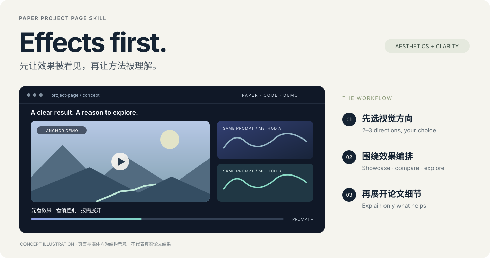

<div align="center">


# PaperProjectPageSkill

**Show the results first. Explain the method next.**

[简体中文](README.md) · **English**

[](https://github.com/yunyangge/PaperProjectPageSkill/actions/workflows/test.yml) [](LICENSE)

Academic project pages · Effects-first presentation · Interactive design · GitHub Pages

</div>

<p align="center">
  
  <br><sub>Original concept illustration, not a completed paper website or experimental result.</sub>
</p>

Give your AI assistant a paper, videos, and figures. Discuss visual directions, then build a project page centered on representative demonstrations, capabilities, and interpretable comparisons. Concise explanations support the visual evidence while retaining clarity and a recognizable identity.

This repository contains an installable **Agent Skill and design references**. An assistant with file-editing and frontend-development tools implements the website. The repository does not provide a standalone website service, a video-generation model, or an additional model API.

## Contents

- [Quick start](#quick-start)
- [Example requests](#example-requests)
- [Design and workflow](#design-and-workflow)
- [Video presentation and interaction](#video-presentation-and-interaction)
- [Reference pages and templates](#reference-pages-and-templates)
- [Inputs, outputs, and publishing](#inputs-outputs-and-publishing)
- [Validation scope](#validation-scope)
- [Repository guide](#repository-guide)
- [FAQ](#faq)

## Quick start

### 1. Install the skill

With Git and Python 3.10+, run in your selected Python environment:

```sh
git clone https://github.com/yunyangge/PaperProjectPageSkill.git
cd PaperProjectPageSkill
python install_skill.py
```

The installer uses only Python's standard library. Use `python3` on macOS where appropriate; Conda users can run `conda run -n py310 python install_skill.py`.

The default destination is `$CODEX_HOME/skills/paper-project-page`, or `~/.codex/skills/paper-project-page` when unset. To update an existing installation while preserving a backup:

```sh
python install_skill.py --upgrade
```

The backup path is printed and stored outside skill discovery. Use `--dest /path/to/skills` to select another compatible agent's **parent skills directory**, or copy the complete [`skills/paper-project-page`](skills/paper-project-page) directory manually. Skill discovery depends on the client.

### 2. Provide the paper and assets

Open your paper or website project in the assistant. Supply LaTeX/PDF, media, figures, and confirmed resource links, then ask:

```text
Use $paper-project-page to build a project page for this paper.
Read the paper and assets, propose 2–3 visual directions, and wait for my choice before implementation.
Lead with demonstrations and keep method explanations secondary.
Support capability browsing, expandable prompts, and comparisons between methods.
```

The assistant inventories the material before discussing the design. Choices already agreed in the conversation carry forward. Missing assets can be planned for, but demonstrations, links, and experimental results must not be invented.

## Example requests

| Task | Ask your assistant |
|---|---|
| Start from a paper | “Read this PDF and video folder; propose a light gallery, a dark showcase, and a restrained editorial direction.” |
| Redesign a page | “Preserve authors, links, and actual results. Lead with demonstrations instead of a full-screen abstract.” |
| Compare one prompt | “Group these methods by shared prompt, with coordinated playback, restart, and full prompt expansion.” |
| Show long-video capability | “Help visitors inspect long-term consistency, label durations and conditions, then explain the mechanism.” |
| Build another kind of research page | “This is not a video-generation paper. Organize its actual figures and input/output examples without forcing video modules.” |
| Publish to GitHub Pages | “Check mobile layout, asset paths, and interactions; publish to my specified repository.” |

## Design and workflow

**See the effect → know what to notice → compare or explore → investigate the method as needed.**

1. **Understand the material.** Read the paper and identify capabilities, demonstrations, comparison settings, and missing assets.
2. **Choose a direction.** Offer 2–3 distinct compositions and reading experiences, not merely different colors. Implement after the user's selection.
3. **Compose the showcase.** Lead with representative effects, then capabilities and comparisons. Method diagrams and key metrics provide supporting evidence.
4. **Implement and iterate.** Reuse the existing stack or choose a lightweight static/component approach that fits the project.
5. **Review and deliver.** Inspect desktop and mobile rendering, playback, switching, links, and deployment paths.

Light galleries, dark showcases, and editorial presentations remain available; recommend afresh for each paper. Keep titles, authors, and resources clear while making a representative demonstration visible early. Visual quality comes from selection, hierarchy, typography, and pacing; decoration supports the research.

See [showcase composition](skills/paper-project-page/references/showcase-composition.md) and [review/delivery](skills/paper-project-page/references/review-delivery.md).

## Video presentation and interaction

These are behaviors the skill guides an assistant to **implement and verify when appropriate**, not a prebuilt video component library:

| Module | Design priority |
|---|---|
| Gallery | Curated main examples, capability groups, expandable collections, useful aspect ratios and sizes |
| Same-prompt comparison | Shared input, clear method labels, interpretable comparison conditions |
| Coordinated playback | Group play/pause/restart; implement and test temporal alignment when required, without calling simultaneous play requests frame synchronization |
| Prompts and settings | Expand long prompts; keep interpretation-critical conditions visible |
| Loading and failures | Posters, staged loading, recoverable errors, no stale video/audio after switching |
| Mobile and accessibility | Touch and keyboard operation; essential information available beyond hover |

See the [video patterns](skills/paper-project-page/references/video-patterns.md).

## Reference pages and templates

Core references are [Helios](https://pku-yuangroup.github.io/Helios-Page/), [Rolling Forcing](https://kunhao-liu.github.io/Rolling_Forcing_Webpage/), [Echo-Infinity](https://echo-team-joy-future-academy-jd.github.io/Echo-Infinity/), and [SAGE-GRPO](https://dungeonmassster.github.io/SAGE-GRPO-Page/): dark presentation, expressive openings, light galleries, and the transition from project identity to evidence.

| Open-source reference | What to learn |
|---|---|
| [Clarity](https://github.com/lorenmt/clarity-template) | Typography, container widths, selection displays, comparison sliders, video controls |
| [Academic Project Page Template](https://github.com/eliahuhorwitz/Academic-project-page-template) | Lightweight HTML, resource buttons, carousels, BibTeX |
| [Academic Project Astro Template](https://github.com/RomanHauksson/academic-project-astro-template) | MDX, equations, wide media, interactive components, static deployment |
| [Nerfies](https://github.com/nerfies/nerfies.github.io) | Demonstrations and interactions that explain capabilities |
| [React + UIKit Academic Project Template](https://github.com/denkiwakame/academic-project-template) | Declarative content configuration; inspect its demo before selecting it |

The [visual library](skills/paper-project-page/references/visual-library.md) records inspection scope, suitable uses, and reuse considerations. This repository does not bundle those projects' code, logos, or research assets. Check their licenses and attribution requirements separately before reuse.

## Inputs, outputs, and publishing

- **Inputs:** LaTeX or PDF, figures, videos/posters, prompts/settings, authors, and Paper/Code/Model/Dataset/Demo links. Source files improve extraction, but are not the only input route.
- **Outputs:** editable website source, a working local preview, organized assets, content-update locations, and an actual verification report. Framework choice depends on the project.
- **Publishing:** local implementation and checks by default; publish to the specified GitHub Pages repository when requested. Installing the skill does not create a website or connect accounts.

Designed for a single paper, research demo, or benchmark page. Personal academic homepages, lab sites, and multi-project portals are outside its main scope.

## Validation scope

The initial version has undergone skill-structure validation, installer tests, and repository-local link checks. CI is configured for Python 3.10/3.12 on Windows, macOS, and Linux; consult [Actions](https://github.com/yunyangge/PaperProjectPageSkill/actions) for actual results.

**A complete real-paper-to-published-site trial has not yet been performed.** Visual inspection of reference sites is not comprehensive playback testing, and design instructions do not automatically guarantee the quality of generated pages. Each site must be checked using its actual assets and deployment target.

A [recent-paper study](benchmarks/README.md) is in progress using Helios, Echo-Infinity, and SAGE-GRPO. Helios and Echo have paper briefs and real-media baselines/revisions covering dark showcases and light galleries. Checks include coordinated playback, late seeking, rapid switching, mobile layout and timed prompts. Echo enlarges mobile comparison videos from roughly 149 to 310 pixels and fixes false success reporting when local long-video seeking fails. Original-site visual comparisons use local source snapshots retaining styles and fonts; full original playback remains unverified. SAGE transfer checks are pending. See the [Helios observations](benchmarks/helios-review.md) and [Echo observations](benchmarks/echo-review.md). Research PDFs/videos remain local and are not distributed with the skill.

## Repository guide

```text
PaperProjectPageSkill/
├── README.md / README.en.md      Chinese and English home pages
├── assets/                      Original logo and concept illustration
├── install_skill.py             Installation, backup upgrades, and restore
├── skills/paper-project-page/
│   ├── SKILL.md                 Agent entry point
│   ├── agents/openai.yaml       Skill display metadata
│   └── references/              Visual library, composition, video, delivery
├── scripts/validate_repository.py
├── tests/                       Installer behavior tests
└── .github/workflows/test.yml   Cross-platform checks
```

## FAQ

**Does this need another API key or MCP server?** The skill has no standalone model service or MCP dependency. Your assistant, browser tools, or optional media services may have their own requirements.

**Can I start with only a PDF?** Yes. Original figures and demo assets help; a PDF cannot supply missing video results.

**Does it force one template?** No. Directions are recommended for the specific paper. The assistant may adapt a template or implement directly; no reference layout or palette is mandatory.

**Does it generate research videos?** Its focus is organizing and presenting existing research assets. Video generation requires the corresponding model and a separate workflow.

**How do I restore a version?** Use the actual backup path printed during upgrade: `python install_skill.py --restore /path/to/backup`. The current installation is backed up before restore.

**How can I improve it?** Provide a real page, screenshot, or reproducible interaction issue. After edits, run:

```sh
python -m unittest discover -s tests -v
python scripts/validate_repository.py
```

Keep both READMEs aligned. Repository organization and bilingual presentation follow [OverleafSkill](https://github.com/yunyangge/OverleafSkill). Original code and documentation are MIT-licensed; external references retain their own rights. This project is not affiliated with the referenced research teams or platforms.
