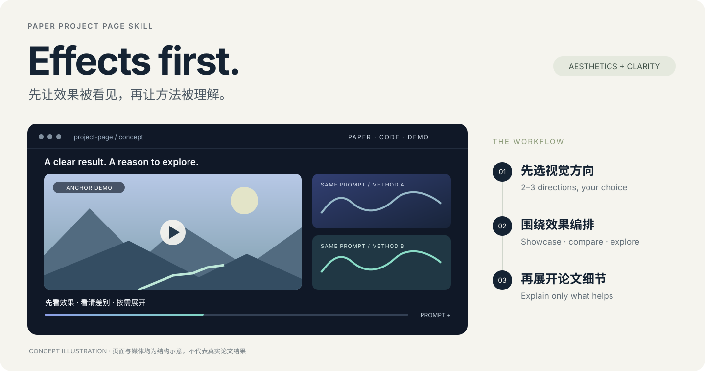

<div align="center">


# PaperProjectPageSkill

**让论文的效果先被看见，再让方法被理解。**

**简体中文** · [English](README.en.md)

[](https://github.com/yunyangge/PaperProjectPageSkill/actions/workflows/test.yml) [](LICENSE)

学术论文项目主页 · 效果展示优先 · 交互式设计 · GitHub Pages

</div>

<p align="center">
  
  <br><sub>原创概念示意，非已生成的真实论文页面或实验结果。</sub>
</p>

把论文、视频和图表交给 AI 助手，先讨论视觉方向，再制作能展示研究效果的项目主页。页面以代表性演示、能力展示和清晰对比为主，方法说明与论文细节为辅，兼顾视觉辨识度和阅读清晰度。

这个仓库提供可安装的 **Agent Skill 与设计参考**。网页由具备文件编辑和前端开发能力的助手实际制作；仓库本身不包含独立建站服务、视频生成模型或额外的模型 API。

## 目录

- [快速开始](#快速开始)
- [你可以这样使用](#你可以这样使用)
- [设计原则与工作流](#设计原则与工作流)
- [视频展示与交互](#视频展示与交互)
- [参考页面与模板](#参考页面与模板)
- [输入、产物与发布](#输入产物与发布)
- [验证范围](#验证范围)
- [仓库导航](#仓库导航)
- [常见问题](#常见问题)

## 快速开始

### 1. 安装 skill

准备 Git 和 Python 3.10+，在选定的 Python 环境运行：

```sh
git clone https://github.com/yunyangge/PaperProjectPageSkill.git
cd PaperProjectPageSkill
python install_skill.py
```

安装器仅使用 Python 标准库。macOS 可将 `python` 换为 `python3`；Conda 用户可使用 `conda run -n py310 python install_skill.py`。

默认安装到 `$CODEX_HOME/skills/paper-project-page`，未设置时为 `~/.codex/skills/paper-project-page`。已有安装可备份升级：

```sh
python install_skill.py --upgrade
```

备份路径会打印到终端，并保存在技能发现目录之外。其他支持 `SKILL.md` 的 Agent 可用 `--dest /path/to/skills` 指定**技能父目录**；也可以手动复制整个 [`skills/paper-project-page`](skills/paper-project-page) 文件夹。不同客户端的技能加载方式以其自身配置为准。

### 2. 提供论文和素材

在助手中打开论文或网页项目目录，提供 LaTeX/PDF、视频、图片及已确认的资源链接，然后说：

```text
使用 $paper-project-page 为这篇论文制作项目主页。
先读取论文和素材，给我 2–3 个视觉方向，选定后再制作。
以效果展示为主，方法说明为辅；视频要能按能力浏览、展开 prompt、对比不同方法。
```

助手读取 skill 后，会先盘点内容与证据，再和你确认视觉方向。已在对话中确认的选择会延续使用。缺少素材时，可以先规划结构，但不能凭空编造演示、链接或实验结果。

## 你可以这样使用

| 想做的事情 | 可以对助手说 |
|---|---|
| 从论文开始 | “读取这份 PDF 和视频目录，先给我浅色画廊、深色展示、克制排版三个方向。” |
| 改造已有页面 | “保留作者、链接和真实结果，把首页改成效果展示优先，别让长摘要占满首屏。” |
| 同 prompt 对比 | “把这些方法按同一个 prompt 分组，支持联动播放、重播和查看完整提示词。” |
| 展示长视频能力 | “让访客能观察长期一致性，标清时长和条件，再解释实现方法。” |
| 做通用论文主页 | “这篇不是视频生成论文，按实际图表和输入输出组织展示，不需要硬加视频模块。” |
| 发布到 GitHub Pages | “检查移动端、资源路径和交互，把页面发布到我指定的仓库。” |

## 设计原则与工作流

**先看到效果 → 知道观察什么 → 比较或探索 → 按需理解原理。**

1. **理解素材。** 阅读论文，找出核心能力、可用的演示、对比条件和缺失资源。
2. **选择方向。** 提供 2–3 个真正不同的构图与阅读方案，而非只换配色；由你选定后展开制作。
3. **编排展示。** 优先放代表性效果，再按能力组织样例和对比；方法图与关键数据随后提供支持。
4. **实现并迭代。** 沿用已有技术栈，或按需求选择轻量静态页面与组件方案。
5. **检查交付。** 实际查看桌面和移动端，检查播放、切换、链接、排版和发布路径。

浅色画廊、深色展示、图文叙事均可使用，每篇论文重新推荐。首屏保留清楚的标题、作者和资源入口，同时让代表性演示尽早可见。美学来自素材选择、主次层级、排版和节奏；装饰与动效为研究效果服务。

详细规则见[展示编排](skills/paper-project-page/references/showcase-composition.md)和[检查与交付](skills/paper-project-page/references/review-delivery.md)。

## 视频展示与交互

以下是 skill 指导助手**按需实现并验证**的交互，不是随安装即获得的视频组件库：

| 模块 | 设计重点 |
|---|---|
| 视频画廊 | 精选主展示、能力分类、更多样例按需展开，保留有用的画幅和尺寸 |
| 同 prompt 对比 | 共享输入、清楚的方法标签、可理解的对比条件 |
| 联动播放 | 组内播放/暂停/重播；需要时间对齐时明确实现与测试，不能把同时调用播放当成逐帧同步 |
| 提示词与参数 | 长 prompt 可展开，关键解释与影响对比结论的条件保持可见 |
| 加载与异常 | 封面、分批加载、失败反馈，切换样例后不残留旧视频或声音 |
| 手机与无障碍 | 可触摸、可键盘操作，重要信息不只藏在悬停中 |

完整规范见[视频交互](skills/paper-project-page/references/video-patterns.md)。

## 参考页面与模板

核心参考包括 [Helios](https://pku-yuangroup.github.io/Helios-Page/)、[Rolling Forcing](https://kunhao-liu.github.io/Rolling_Forcing_Webpage/)、[Echo-Infinity](https://echo-team-joy-future-academy-jd.github.io/Echo-Infinity/) 和 [SAGE-GRPO](https://dungeonmassster.github.io/SAGE-GRPO-Page/)。分别借鉴深色展示、醒目首屏、浅色画廊、品牌与论文证据的衔接。

| 开源参考 | 主要借鉴点 |
|---|---|
| [Clarity](https://github.com/lorenmt/clarity-template) | 图文层级、容器宽度、样例选择、滑块对比与视频控制 |
| [Academic Project Page Template](https://github.com/eliahuhorwitz/Academic-project-page-template) | 轻量 HTML、资源按钮、轮播、BibTeX |
| [Academic Project Astro Template](https://github.com/RomanHauksson/academic-project-astro-template) | MDX、公式、宽幅媒体、交互组件与静态发布 |
| [Nerfies](https://github.com/nerfies/nerfies.github.io) | 用演示与交互解释方法能力 |
| [React + UIKit Academic Project Template](https://github.com/denkiwakame/academic-project-template) | 声明式内容配置；在实际选用前还需查看演示 |

[视觉参考库](skills/paper-project-page/references/visual-library.md)记录了观察范围、适用场景和复用注意事项。本仓库不附带这些项目的源码、Logo 或论文素材；复制第三方代码或资产时需单独核对其许可证与署名要求。

## 输入、产物与发布

- **输入：** LaTeX 源码或 PDF、图表、视频与封面、prompt/实验条件、作者信息、Paper/Code/Model/Dataset/Demo 链接。完整源码有助于准确提取内容，但不是唯一入口。
- **产物：** 可编辑的网页源码、可用的本地预览、素材组织、内容更新位置及实际检查记录。输出框架由项目需求决定。
- **发布：** 默认先在本地制作和检查；明确要求后可发布到指定 GitHub Pages 仓库。创建 skill 不会自动创建网站或连接账号。

适合单篇论文、研究 Demo 和 Benchmark 项目页。个人学术主页、实验室网站、多项目门户不属于这个 skill 的主要范围。

## 验证范围

初版已进行 skill 结构校验、安装器测试与仓库内部链接检查。CI 配置覆盖 Windows、macOS、Linux 的 Python 3.10/3.12；实际运行结果以 [Actions](https://github.com/yunyangge/PaperProjectPageSkill/actions) 为准。

**尚未完成真实论文从素材到发布的完整试跑。** 参考站点的视觉观察不等于逐项播放测试，设计规则也不代表每次生成的页面自动合格。每个页面仍需用实际素材验证效果、播放行为与发布结果。

已完成[三篇近期论文的本地实测与迭代](benchmarks/study-results.md)：Helios、Echo-Infinity、SAGE-GRPO，分别采用深色展示、浅色画廊和图文展示方向。每篇都有 PDF 阅读简报、真实素材首版、原站对照与修订；检查覆盖联动播放、后段定位、快速切换、手机布局、定时提示词和短片慢放。Echo 的手机比较宽度约 149→310 像素；SAGE 验证了大幅比较对与独立分组控制的迁移。原站观察结合实际页面及保留样式的本地快照，未验证其全部播放体验。详见 [Helios](benchmarks/helios-review.md)、[Echo](benchmarks/echo-review.md)、[SAGE](benchmarks/sage-review.md) 的检查记录与限制。研究视频/PDF 仅在本地保存，不随 skill 分发。

## 仓库导航

```text
PaperProjectPageSkill/
├── README.md / README.en.md      中英文项目首页
├── assets/                      原创标志与概念示意图
├── install_skill.py             安装、备份升级与恢复
├── skills/paper-project-page/
│   ├── SKILL.md                 Agent 入口
│   ├── agents/openai.yaml       技能展示信息
│   └── references/              视觉库、展示编排、视频交互、检查交付
├── scripts/validate_repository.py
├── tests/                       安装器行为测试
└── .github/workflows/test.yml   跨平台检查
```

## 常见问题

**需要额外 API Key 或 MCP 吗？** 本 skill 没有独立模型服务或 MCP 依赖。你使用的助手、浏览器工具或可选媒体服务可能有自身要求。

**只有 PDF 可以用吗？** 可以。提供原始图表和演示素材会更好；PDF 本身不会提供缺失的视频结果。

**会固定套一个模板吗？** 不会。每次根据论文内容推荐视觉方向，可以借鉴模板，也可以直接实现；不会把参考站点的配色和布局设为唯一答案。

**能自动生成视频吗？** 这里重点是组织和展示已有研究素材。视频生成需要对应模型与单独的工作流。

**怎么恢复旧版？** 使用升级时打印的实际备份路径：`python install_skill.py --restore /path/to/backup`。恢复前也会保留当前安装的副本。

**怎么参与改进？** 提供真实页面、截图或可复现的交互问题；修改后运行：

```sh
python -m unittest discover -s tests -v
python scripts/validate_repository.py
```

请同步维护中英文 README。仓库结构与双语阅读方式参考 [OverleafSkill](https://github.com/yunyangge/OverleafSkill)。原创代码与文档采用 MIT 许可证；外部参考项目保留各自权利。本项目与所列论文团队及平台无隶属关系。
